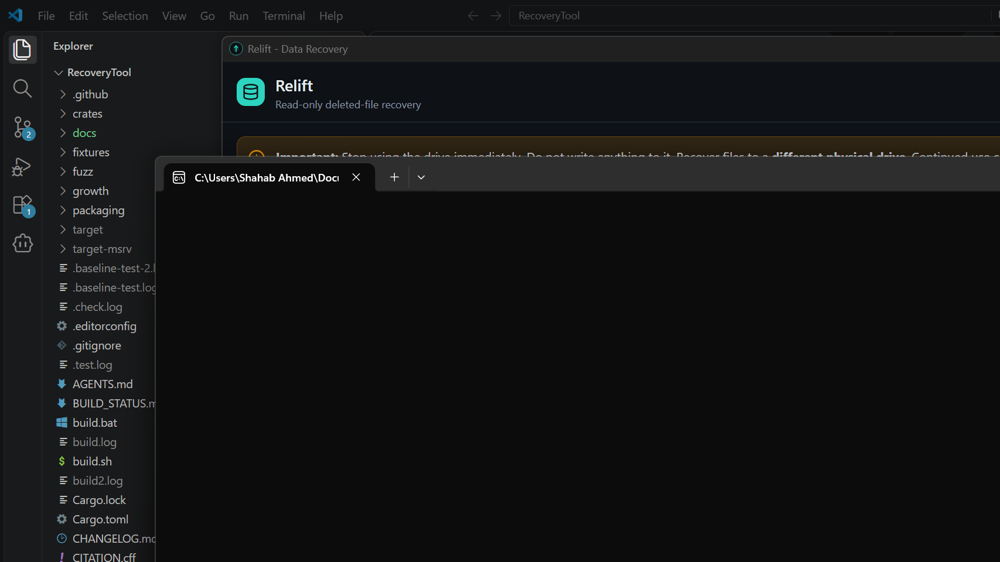

# Relift

Read-only deleted-file recovery for disk images and drives.

Relift scans disk images and raw devices without writing to them, records what it finds in a session directory, and recovers validated byte ranges only to a separate destination. Unsupported filesystems and unvalidated carves are reported, never silently presented as recovered.

## Canonical identity

- **Name:** Relift (binary `relift`)
- **License:** GPL-3.0-or-later
- **Stack:** Rust 1.90+; the Windows release target uses MSVC
- **Crates:** `relift-core`, `relift-cli`, `relift-testkit`, `relift-gui`, `relift-bench`

## Features

- **Read-only-by-construction:** `ReadOnlySource` exposes no write method; the engine cannot modify the source device.
- **Byte-for-byte recovery verified against synthetic fixtures with SHA-256.**
- **Filesystem metadata recovery:** FAT12/16/32, exFAT, NTFS, ext2/3/4 (fixture-validated); HFS+, APFS, Btrfs and XFS parsers are implemented but only lightly exercised (experimental).
- **Signature carving:** structurally validated formats listed in [`docs/support-matrix.md`](docs/support-matrix.md); unvalidated formats such as ZIP64 are not emitted.
- **Sparse-file segment preservation:** holes and unwritten extents keep byte offsets.
- **Destination safety:** output proven separate from evidence before any write.
- **SHA-256 verification** of every recovered file (on by default).
- **Session-based workflow:** scan → session → recover → report (JSON/HTML/CSV). Completed scan results persist in the session, and a cancelled or crashed scan can be continued with `--resume` after the source identity is revalidated.
- **`devices` and `doctor`** report device accessibility and run local self-tests; they do not diagnose SMART health or TRIM status.
- **No telemetry;** default offline.
- **GUI (Tauri 2 + Svelte 5):** source selection, scan progress, result filtering and preview, and recovery to a selected destination. Imaging and report export remain CLI-only.
- **CLI:** scriptable commands, JSON output, and shell completions. See [`docs/CLI.md`](docs/CLI.md) for the implemented command set.

## Quick start

Image a raw device, then scan the image (recommended over scanning a mounted volume):

```sh
relift image \\.\PhysicalDrive1 --dest D:\images\evidence.dd
relift scan D:\images\evidence.dd --session D:\session
relift recover D:\session --dest D:\recovered
```

Scan an image directly:

```sh
relift scan image.dd --session ./session --live --carve
relift recover ./session --dest ./out
```

Continue an interrupted scan (the source must be unchanged):

```sh
relift scan image.dd --session ./session --resume
```

List devices:

```sh
relift devices
```

Run self-tests:

```sh
relift doctor
```

## Exit codes

| Code | Meaning |
|------|---------|
| 0 | OK |
| 1 | RUNTIME |
| 2 | USAGE |
| 3 | UNSAFE (destination safety refusal) |
| 4 | MISMATCH (source != session) |
| 5 | PARTIAL |

See `docs/CLI.md` for the full command reference.

## GUI

Relift includes a desktop GUI built with Tauri 2 and Svelte 5:

| Screen | Description |
|--------|-------------|
|  | **Source picker** - visible devices and raw images with access status |
|  | **Scan** - live progress and a stop action that keeps partial results |
|  | **Results** - filterable table, candidate metadata |
|  | **Recovery** - destination selection and recovery summary |

The [v0.1.0 preview release](https://github.com/ShahabAhmed01/relift/releases/tag/v0.1.0) includes desktop bundles for Windows, macOS, and Linux plus CLI archives for five targets. The attached `SHA256SUMS` manifest matches the uploaded assets. All assets are unsigned; hashes detect byte mismatches but do not authenticate the publisher. The preview is tested on synthetic images only; no real drive or representative recovery corpus has been validated.

## Comparison

No reproducible, head-to-head recovery or performance comparison has been run.
Relift's filesystem and format claims are limited to the evidence in the
[support matrix](docs/support-matrix.md) and [verification record](docs/VERIFICATION.md).
Choose a tool based on its tested support for your filesystem and recovery case;
Relift is not a replacement for partition repair, RAID reconstruction, or a
certified forensic suite.

## Benchmarks

Performance targets are tracked in `docs/benches/METHODOLOGY.md`. Published measurements are not yet available; run `cargo bench -p relift-bench` locally and record the machine details before quoting numbers.

| Metric | Target | Method |
|--------|--------|--------|
| Cold start (CLI) | < 50 ms | `hyperfine` median of 100 runs |
| GUI cold start | < 400 ms | Tauri `window_created` → first paint |
| Deep scan sweep | ≥ 4 GB/s | 64 MB test buffer, `memchr` SIMD |
| Deep scan full | ≥ 1.5 GB/s | Real fixtures, all carvers |
| Quick scan (1 TB NTFS) | < 90 s | 1M MFT records, NVMe |
| Memory (4 TB scan) | < 350 MB RSS | Bounded streaming, no full buffering |
| Binary size (release) | < 30 MB | `strip`, LTO, single codegen unit |

See `docs/benches/METHODOLOGY.md` for full methodology.

## Documentation

- [Docs site](https://shahabahmed01.github.io/relift/) — full documentation site

- `docs/CLI.md` — command and exit-code reference
- `docs/architecture.md` — system design
- `docs/support-matrix.md` — tested/untested filesystem and platform matrix
- `docs/threat-model.md` — threats and mitigations
- `docs/limitations.md` — known gaps and exclusions
- `docs/GAP_REPORT.md` — tracked gaps
- `docs/VERIFICATION.md` — how recovery is validated
- `docs/decisions/CONFLICT_REGISTER.md` — reconciled names/stacks/licenses
- `docs/decisions/ADR-0001…0006` — architecture decision records
- `docs/research/landscape.md` — pre-architecture research
- `docs/benches/METHODOLOGY.md` — benchmark methodology
- `docs/benches/results/` — published benchmark CSVs

## Building

Requires Rust 1.90+ via rustup. On Windows the MSVC toolchain is recommended (`rustup default stable-x86_64-pc-windows-msvc`):

```sh
cargo build --release --workspace
```

The CLI binary is `target/release/relift.exe` (Windows) or `target/release/relift` (Unix). The GUI is a Tauri application that requires Node.js 22.17 or newer; build it through the Tauri CLI so the frontend is embedded:

```sh
cd crates/relift-gui
npm ci
npm run tauri build
```

## Tests

```sh
cargo test -p relift-core
cargo test --workspace --all-targets
```

The current suite has 93 passing tests: core unit tests, end-to-end recovery tests (FAT32, exFAT, NTFS, ext4), fixture tests, CLI unit tests, CLI process-level contract tests, GUI DTO contract tests, carver validation tests (JPEG, PNG, GIF, BMP, TIFF, WebP, HEIC, AVIF, PDF, DOCX, XLSX, PPTX, MP4, MKV, WAV, MP3, OGG, SQLite, PST, LNK, EVTX, ZIP, 7z, RAR4, gzip, bzip2, xz, zstd, tar, FLAC, OLE, MPEG-TS, RAR5, ISO 9660), probe detection tests (HFS+, APFS, Btrfs, XFS), fuzz targets for carver and filesystem parsers, and end-to-end resume tests. These use deterministic synthetic fixtures; they do not establish recovery accuracy on real volumes. cargo-fuzz harnesses are checked in under `fuzz/` and run in CI on Linux runners.

## Honesty policy

Relift publishes only what is actually verified. No simulated results, no faked benchmarks/screenshots/stars/reviews/release claims, no telemetry. Unsupported filesystems are identified and reported, never silently claimed.

## Limitations

See `docs/limitations.md` and `docs/GAP_REPORT.md` for details. Notable gaps:

- NTFS: `$ATTRIBUTE_LIST`, named ADS, compression, EFS, `$UsnJrnl` not recovered.
- ext4: inline data >60 bytes, encryption, bigalloc, journal replay not implemented.
- Carving: ZIP64 not validated (handled by the ZIP validator).
- No real NTFS/ext4 volumes available locally; only synthetic fixtures tested.
- The v0.1.0 preview is published; no stable release has been published.
- No signing certificates/notarization credentials; release artifacts are unsigned. `SHA256SUMS` is attached but does not authenticate the publisher.
- macOS raw-device destination safety intentionally fails closed; macOS raw paths untested.
- Desktop GUI requires WebView2 on Windows.

## License

GPL-3.0-or-later. See `LICENSE`.

## Contributing

See `CONTRIBUTING.md`. Architecture overview, carver contribution guide, test fixture workflow.

## Security

See `SECURITY.md`. Threat model, vulnerability disclosure, signed-release verification.

## Acknowledgements

Built with Rust crates including `serde`, `serde_json`, `clap`, `memchr`, `crc32fast`, `flate2`, `sha2`, `thiserror`, `anyhow`, `chrono`, `tauri`, and `criterion`; the GUI uses Svelte 5 and TypeScript.

