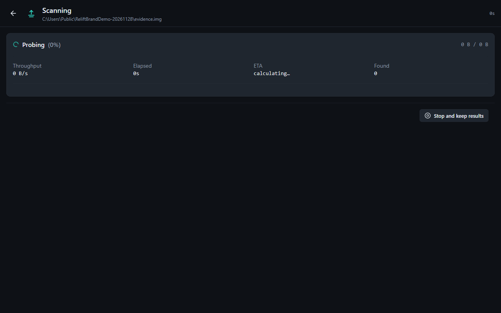
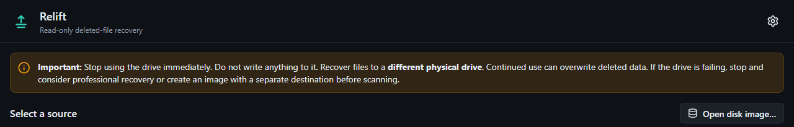
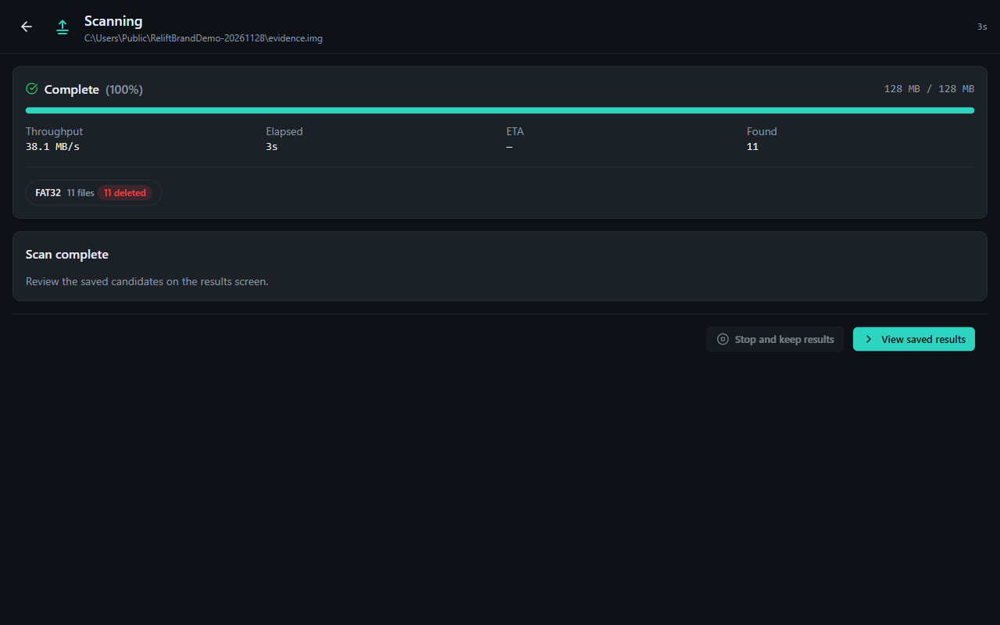
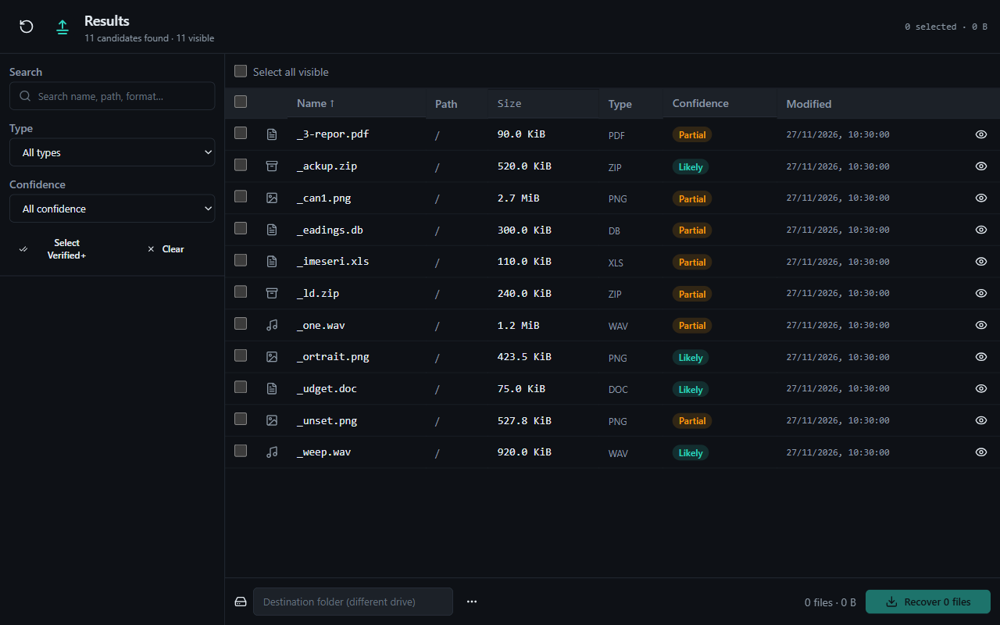
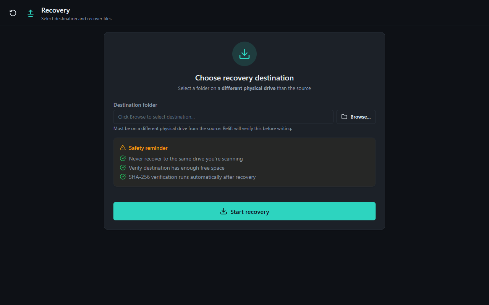
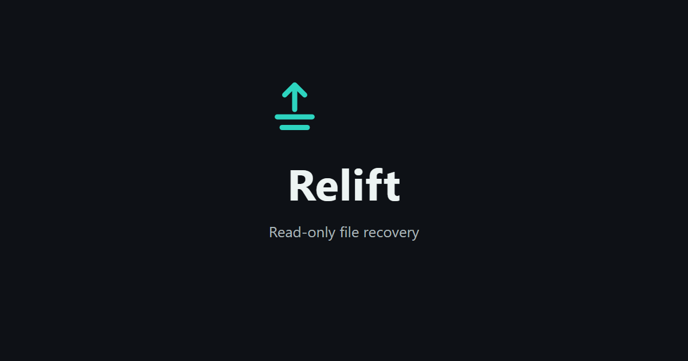

# Relift

<p align="center">
  
</p>

**Read-only deleted-file recovery for raw disk images and drives.**

Relift scans disk images and raw devices without writing to them, records what it finds in a session directory, and recovers validated byte ranges only to a separate destination. Unsupported filesystems and unvalidated carves are reported, never silently presented as recovered.

> **Status: v0.1.0 preview.** Validation is limited to deterministic synthetic fixtures. No real drive, deleted volume, or representative recovery corpus has been validated. Release binaries are unsigned and not notarized. Do not rely on Relift as the only copy or recovery method for important data.

> **Safety first.** Never write to the source device. Always recover to a different physical volume than the one you are scanning. Use `--dry-run` before writing any recovered files. Stop using the drive immediately after deletion — continued use overwrites deleted data.

[](https://github.com/ShahabAhmed01/relift/actions/workflows/ci.yml)
[](https://github.com/ShahabAhmed01/relift/releases/tag/v0.1.0)
[](LICENSE)
[](Cargo.toml)
[](https://github.com/ShahabAhmed01/relift/actions/workflows/ci.yml)

<p align="center">
  
</p>

<p align="center"><sub>Captured from the running Windows app. The demo scans generated synthetic data and stops before any recovery write.</sub></p>

<details>
<summary>View real app screenshots</summary>








</details>

## Why Relift

Relift is built for situations where deleted data still exists on the media but
filesystem metadata no longer points to it. Every design decision prioritizes
the safety of the evidence over the speed of the recovery.

- **Read-only by construction.** `ReadOnlySource` exposes no write method, so
  the recovery engine cannot modify the source. Imaging and recovery write only
  to an explicitly selected destination.
- **Raw-device output is checked before writes.** Relift refuses a session or
  recovery destination on the same physical disk as a raw source, including
  partition and stacked-device ancestry on Linux. For image-file sources,
  choose a separate physical volume manually.
- **Recovery is verified, not assumed.** Recovered files are hashed with SHA-256
  by default. The check proves the destination bytes match what was read back;
  it does not prove they match an unknown original file.
- **Carving requires structural validation.** A magic-byte match alone is never
  emitted as a candidate. The registry has 153 format identifiers, including
  marker-only entries; candidates are emitted only when a format validator
  accepts their structure. Registry size is not a count of equally mature
  formats.
- **Sessions are inspectable and resumable.** Scan results are stored as
  JSON/JSONL, and an interrupted scan can continue with `relift scan --resume`
  after the source identity is revalidated.
- **Offline by default.** Relift contains no network client and sends no
  telemetry.

## What it does

| Area | Implemented | Evidence status |
|---|---|---|
| Filesystem metadata recovery | FAT12/16/32, exFAT, NTFS, ext2/3/4 | Fixture-validated end to end with SHA-256 |
| Filesystem detection | HFS+, APFS, Btrfs, XFS, ReFS, F2FS, ZFS, ReiserFS, ISO 9660, UDF | HFS+/APFS/Btrfs/XFS have probe fixtures; the rest are detection-only |
| Signature carving | 153 registered identifiers; only validator-backed formats emit | Unit-tested inputs; no real-media corpus |
| Sparse files | Holes and unwritten extents keep byte offsets | Fixture-tested |
| CLI | scan, recover, image, devices, doctor, report, completions | Process-level contract tests |
| GUI | source selection, scan progress, filtering, preview, recovery | Tauri 2 + Svelte 5; see [GUI docs](docs/src/GUI.md) |

HFS+, APFS, Btrfs, and XFS parsers are implemented and wired into scanning, but metadata-based deleted-file recovery on those filesystems is experimental. Only probe detection has deterministic fixtures. See the [support matrix](docs/src/support-matrix.md) for the exact boundary.

## Install

### Prebuilt preview

Download the bundle for your platform from the [v0.1.0 preview release](https://github.com/ShahabAhmed01/relift/releases/tag/v0.1.0):

- Windows: `.msi` or `-setup.exe`
- macOS: `.dmg` (universal)
- Linux: `.AppImage`, `.deb`, or `.rpm`
- CLI-only archives for Windows x86_64, macOS x86_64/ARM64, and Linux x86_64/ARM64

The release includes `SHA256SUMS`. On Linux or macOS, verify a download with:

```sh
sha256sum --check SHA256SUMS
```

All assets are unsigned and not notarized. Checksums detect byte mismatches; they do not authenticate the publisher. Package-manager manifests in `packaging/` are drafts and have not been submitted.

### From source

Requires Rust 1.90 or newer. On Windows the MSVC toolchain is recommended:

```sh
rustup default stable-x86_64-pc-windows-msvc
cargo build --release --workspace
```

The CLI binary is `target/release/relift` (`relift.exe` on Windows). The GUI needs Node.js 22.17 or newer and the Tauri CLI:

```sh
cd crates/relift-gui
npm ci
npm run tauri build
```

## Quick start

Work on an image, not a live volume, whenever possible:

```sh
relift image /dev/sdX --dest /mnt/backup/evidence.dd
relift scan /mnt/backup/evidence.dd --session ./session
relift recover ./session --dest /mnt/recovery --dry-run
relift recover ./session --dest /mnt/recovery
```

`--dry-run` prints what would be written without writing it. Always recover to a different physical volume from the source.

Scan an existing raw image with carving:

```sh
relift scan image.dd --session ./session --mode deep
relift recover ./session --dest ./out --filter 'ext:jpg,png,pdf' --min-confidence verified
```

Continue an interrupted scan (the source must be unchanged):

```sh
relift scan image.dd --session ./session --resume
```

Other commands:

```sh
relift devices      # list visible devices and access status
relift doctor       # run local self-tests
relift partitions-scan image.dd --session ./partition-catalog
relift verify ./session --json
relift report ./session --format html --out report.html
```

The CLI accepts a TOML config file with `--config FILE`, or searches for
`./relift.toml` and the user config file. Config defaults apply to `scan`,
`list`, and `recover`; CLI values override them. See the
[CLI reference](docs/src/CLI.md) for the schema and all options.

See the [CLI reference](docs/src/CLI.md) for every option and the exit-code contract.

## Synthetic demo

Synthetic demo data and scripts are kept in `docs/assets/demo/`. The new GIF
and screenshots under `verified-2026-11-28/` are captures of the running Tauri
app against a generated FAT32 image. Older flat demo media and files under
`docs/assets/screenshots/` retain contradictory provenance and are not used in
the README. See the [capture record](docs/assets/demo/verified-2026-11-28/PROVENANCE.md).

On Windows, the PowerShell runner creates a fresh synthetic image, scans it,
and shows a dry run. It requires an existing destination on a different
physical disk;
writing recovered files requires `-WriteRecoveredFiles` and typing `RECOVER`
after reviewing the dry-run summary:

```powershell
powershell -File docs/assets/demo/scripts/run-demo.ps1 `
  -ReliftPath .\target\release\relift.exe `
  -DemoDirectory .\relift-demo `
  -RecoveryDestination E:\relift-recovery
```

## Exit codes

| Code | Meaning |
|---|---|
| 0 | OK |
| 1 | RUNTIME |
| 2 | USAGE |
| 3 | UNSAFE (destination safety refusal) |
| 4 | MISMATCH (source != session) |
| 5 | PARTIAL |

## GUI

The desktop app uses Tauri 2 and Svelte 5. It supports source selection, quick and deep scans with real progress events, result filtering and preview, destination selection, and recovery with hash verification. Imaging, report export, and checkpoint resume remain CLI-only.

The GUI images in the repository have not been verified as captures of the
application. Re-capture from the current build before using visuals to describe
product features.

## Evidence and limitations

- **Validation boundary:** FAT32, exFAT, NTFS, and ext4 recovery is proven on deterministic synthetic images with byte-exact SHA-256 comparison. HFS+/APFS/Btrfs/XFS detection is proven on probe fixtures. No physical media has been validated.
- **Not tested:** SSD TRIM/garbage collection, failing drives, hardware encryption, RAID/multi-device volumes, E01/AFF4/VHD/VMDK/QCOW2/DMG containers, and real-world fragmentation.
- **Unsigned:** no Authenticode certificate, Apple Developer ID, or notarization credentials are configured.
- **No telemetry:** Relift makes no network calls during scanning or recovery.

Full detail: [verification record](docs/src/VERIFICATION.md), [support matrix](docs/src/support-matrix.md), [known gaps](docs/src/GAP_REPORT.md), [limitations](docs/src/limitations.md), and [threat model](docs/src/threat-model.md).

## Comparison

No reproducible head-to-head recovery or performance comparison has been run. Relift's claims are limited to the evidence in the [support matrix](docs/src/support-matrix.md) and [verification record](docs/src/VERIFICATION.md). Choose a tool based on its tested support for your filesystem and recovery case. Relift is not a replacement for partition repair, RAID reconstruction, or a certified forensic suite.

## Benchmarks

Targets and measured results are kept separate. The latest recorded run (2026-11-26, Windows 11 x86_64, Rust 1.100) is documented in [`docs/benches/METHODOLOGY.md`](docs/benches/METHODOLOGY.md). Raw benchmark output is generated locally with `cargo bench -p relift-bench` and is not committed to the repository:

| Metric | Target | Latest measured |
|---|---|---|
| Signature sweep (64 MiB buffer) | >= 4 GB/s | 3.74-4.00 GiB/s |
| JPEG validation (1 MiB) | - | 6.20-6.52 ms |
| ZIP validation (1 MiB) | - | 6.26-6.59 ms |
| FAT32 metadata scan | - | 212-223 us |
| NTFS metadata scan | - | 1.01-1.07 ms |
| ext4 metadata scan | - | 786-802 us |
| Filesystem probes | - | 49-72 us |
| Quick scan (1 TB NTFS) | < 90 s | not measured |
| Memory (4 TB scan) | < 350 MB RSS | not measured |

The sweep result is below its 4 GB/s target and regressed against the previous local baseline. See [`docs/benches/METHODOLOGY.md`](docs/benches/METHODOLOGY.md) before quoting numbers.

## Documentation

- [Documentation site](https://shahabahmed01.github.io/relift/)
- [CLI reference](docs/src/CLI.md)
- [Architecture](docs/src/architecture.md)
- [Support matrix](docs/src/support-matrix.md)
- [Competitive analysis](docs/research/COMPETITIVE_ANALYSIS.md)
- [Threat model](docs/src/threat-model.md)
- [Limitations](docs/src/limitations.md)
- [Gap report](docs/src/GAP_REPORT.md)
- [Verification record](docs/src/VERIFICATION.md)
- [Architecture decision records](docs/decisions/)
- [Benchmark methodology](docs/benches/METHODOLOGY.md)

## Tests

```sh
cargo fmt --all -- --check
cargo clippy --workspace --all-targets -- -D warnings
cargo test --workspace --all-targets
cargo doc --workspace --no-deps
```

The current workspace run passed 112 tests across core, CLI, GUI, testkit, and end-to-end targets. CI runs the suite on Linux, macOS, and Windows with stable Rust and the 1.90 MSRV. These tests use deterministic synthetic fixtures; they do not establish recovery accuracy on real volumes.

## Security

See [SECURITY.md](SECURITY.md) for vulnerability disclosure and the security model. Relift opens sources read-only and refuses unsafe destinations; it does not sandbox a hostile local process that already has write access to the destination.

## Contributing

See [CONTRIBUTING.md](CONTRIBUTING.md). New carvers need valid, truncated, and malformed fixtures before registration.

## License

GPL-3.0-or-later. See [LICENSE](LICENSE).

---

<p align="center">
  
</p>

<p align="center">
  <a href="https://shahabahmed01.github.io/relift/">Documentation site</a> ·
  <a href="docs/src/CLI.md">CLI reference</a> ·
  <a href="docs/src/support-matrix.md">Support matrix</a> ·
  <a href="docs/src/VERIFICATION.md">Verification record</a> ·
  <a href="SECURITY.md">Security policy</a> ·
  <a href="CONTRIBUTING.md">Contributing</a>
</p>


