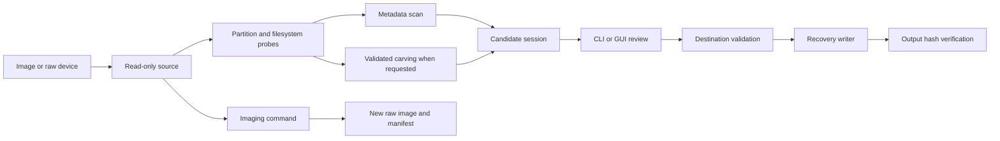

# Architecture

Relift is a Rust workspace with one shared recovery library, a native CLI, a
Tauri desktop application, deterministic test fixtures, and a Criterion
benchmark crate. The CLI and GUI call the same `relift-core` APIs.

## Data flow

## Crate responsibilities

| Crate | Responsibility |
|---|---|
| `relift-core` | Read-only sources, device enumeration, partition and filesystem parsing, carving validation, sessions, safe recovery and imaging writers, reports |
| `relift-cli` | `devices`, `scan`, `list`, `recover`, `image`, `doctor`, `report`, `version`, and shell completion commands |
| `relift-gui` | Tauri 2 commands and Svelte 5 interface backed by `relift-core` |
| `relift-testkit` | Deterministic synthetic disk and filesystem fixtures used by tests |
| `relift-bench` | Criterion microbenchmarks; results are not a substitute for real-media performance measurements |

## Source and scan path

`ReadOnlySource` provides positional reads and identity information but has no
write operation. The CLI and GUI open regular image files or platform raw
devices through this abstraction. Raw-device access and physical-disk
identification have platform-specific limits described in
[`support-matrix.md`](support-matrix.md).

The scanner probes partitions and supported filesystems. Quick mode scans
metadata; deep mode also runs the signature validators. Metadata and carve
results become `Candidate` records with source locations, extents, recovery
method, and confidence. Experimental parsers are listed separately from
fixture-validated filesystems.

## Session format

A session is a directory, not a database:

- `session.json` stores schema version, source identity, scan options, summary,
  filesystem reports, warnings, and recovery totals.
- `candidates.jsonl` stores one candidate per line and is appended as results
  are produced.
- `recovered.jsonl` records recovery results.
- `README.txt` describes the session.

Candidate records stream to disk rather than being accumulated into one
in-memory result list. A completed session can be listed, recovered, or
reported again. Resuming an interrupted scan from a checkpoint is not
implemented.

## Recovery and imaging writes

The recovery path opens and validates the source, compares its identity with
the session, validates the destination, then writes only under the selected
destination directory. Destination handling uses anchored directory handles,
no-follow path traversal, and collision-safe file creation/finalization. On
supported platforms, same-device destinations are rejected; cases whose
physical backing cannot be proven fail closed. Platform details and remaining
limits are in [`GAP_REPORT.md`](GAP_REPORT.md).

Recovered files are re-read and SHA-256 checked by default. `--no-verify`
disables this post-write check. The `image` command copies from a read-only
source to a new raw image destination and writes a SHA-256 manifest; it does not
overwrite an existing destination.

## Interfaces

The CLI exposes the complete current command set and machine-readable JSON.
The GUI covers source selection, scanning, result review, preview, and recovery.
Imaging and report-format selection remain CLI-only. The GUI can stop a scan
and keep partial results; it does not pause and resume a running scan. See
[`CLI.md`](CLI.md) and [`GUI.md`](GUI.md) for user-facing behavior.

## Verification boundaries

Tests prove behavior on deterministic synthetic fixtures, including byte-level
recovery comparisons and destination safety cases. CI builds and tests the
workspace on Windows, macOS, and Linux. No real physical disk or real deleted
volume has been validated yet; no accuracy percentage or hardware performance
target is claimed. See [`VERIFICATION.md`](VERIFICATION.md).
